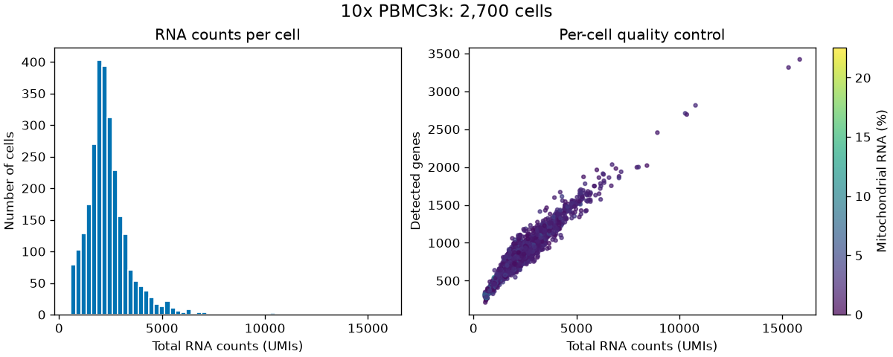

# Notebook Workflow

Use Codex to debug, edit, and refactor Python and R notebooks, then continue
running cells in VS Code with your existing kernel.

Notebook Workflow is a Codex skill and local tool that gives the assistant your
notebook's code and Markdown without its stored cell outputs. It brings edits
back into the original notebook and preserves unaffected results, so AI
assistance fits into your interactive analysis workflow.

## Why use it?

A saved notebook contains more than code. Charts, images, and other cell outputs
can make the file large. When an assistant reads the full notebook file, those
stored results can consume much of its context. A code edit also needs to account
for old results that may no longer match the calculation.

Notebook Workflow helps you:

- **Give the assistant useful context.** It works from the code and explanatory
  notes in a lightweight script, with stored cell outputs kept outside its input.
- **Keep unaffected results.** Independent plots and outputs remain available;
  results affected by code changes are cleared for rerunning.
- **Keep your existing environment.** Conversion runs locally in its own tooling
  environment. Your Python or R kernel and analysis dependencies stay in place.
- **Use one installation across projects.** The skill follows each project's
  conventions without depending on a particular scientific library or dataset.

The reduction in input size depends on the notebook and how your assistant
normally reads it. Notebooks with large saved outputs benefit most; Markdown,
including any inline image data, remains in the script.

## Measured example: 95.3% fewer input-text tokens

We ran a **one-code-cell PBMC3k QC notebook** using
[`scanpy.datasets.pbmc3k()`](https://scanpy.readthedocs.io/en/stable/generated/scanpy.datasets.pbmc3k.html)
(2,700 cells), saved its real plots, then used the skill to change the histogram
from 40 to 60 bins. The tool cleared the edited cell's old output; rerunning it
regenerated the figure with unchanged QC summary values.

For the same edit request, measured with the `o200k_base` tokenizer:

| Input text | Tokens |
| --- | ---: |
| Full saved notebook + request, without the skill | 61,715 |
| Exported script + request | 710 |
| Skill workflow, including its instructions and command/response summaries | **2,895** |

**58,820 fewer tokens (95.3%)**, including the skill's overhead. The original
notebook contains one real embedded PNG; no synthetic output padding was added.
These are input-text payload counts, **not billed model usage or total
conversation tokens**. If an assistant already extracts cell source instead of
reading notebook JSON, that baseline is only **491 tokens** here; the 95.3%
saving does not apply to it.



See the [before figure](examples/pbmc3k/figures/qc-before.png),
[recorded measurements](examples/pbmc3k/report.json), and
[benchmark method](docs/pbmc3k-demo.md#what-the-token-counts-measure).

### Reproduce the example

From this repository's root, use **Python 3.12+** for the optional Scanpy example:

```bash
python3 -m venv .venv-pbmc3k
.venv-pbmc3k/bin/python -m pip install -e . -r examples/pbmc3k/requirements.txt
.venv-pbmc3k/bin/python examples/pbmc3k/run_demo.py replay
```

This downloads PBMC3k, executes the notebook, replays the same tool operations and
fixed edit, reruns the edited cell, and writes figures and token counts under
`notebook-workflow-benchmarks/pbmc3k/`. That folder is ignored; the dataset and
executed notebooks are kept out of the repository. Replay makes no model call.
Counts vary with rendering, first-download messages, paths, and generated cell labels.

For another run, add `--output notebook-workflow-benchmarks/pbmc3k-rerun` before
`replay`. To try the edit with Codex yourself, follow the
[step-by-step example](docs/pbmc3k-demo.md#try-it-with-codex).

## When to use it

Use it for requests such as:

- Fixing notebook code after an error.
- Moving repeated analysis code into reusable functions or project modules.
- Updating a calculation or parameter while preserving the surrounding analysis.

For example:

```text
Use $notebook-refactor to update notebooks/analysis.ipynb:
Move the repeated preprocessing into a reusable function and preserve its behavior.
```

## How it works

1. **Prepare.** The saved notebook is exported to a temporary script containing
   its code and notes. The VS Code integration saves the open notebook first.
2. **Edit.** Codex works on that script and, when your request calls for it,
   relevant project modules.
3. **Preview and apply.** The tool previews the cell changes and applies them
   back to the notebook. Changed code and dependent cells lose their saved
   outputs; unaffected cells keep their state. Uncertain dependencies trigger
   broader clearing, reported in the preview.
4. **Continue your analysis.** Inspect the refreshed notebook and rerun affected
   cells using your chosen kernel.

Your notebook remains the source of truth. Pause its editing and execution during
assistance; the tool refuses conflicting edits and retains recovery backups.
It does not execute your analysis automatically.

## Get started

You need Python 3.10+ for the local tool, Codex, and VS Code for the integrated
notebook workflow. Download or clone this repository into a stable local folder,
then run from its root:

```bash
python3 install.py
python3 install.py --vscode-only
```

The second command requires the VS Code `code` command on PATH. Reload VS Code
and restart Codex if the skill has not appeared. Open a saved Python or R notebook
and ask for help using `$notebook-refactor`, as in the example above.

Locally stored notebooks can use local or remote kernels. The editor integration
has been validated on macOS; see the [installation guide](docs/installation.md)
for platform scope, manual save/reopen without VS Code, and migration from an
older installation.

## Documentation and examples

- [Installation](docs/installation.md): setup, custom paths, CLI-only use, and migration.
- [Usage and recovery](skills/notebook-refactor/references/workflow.md): previews,
  dependency handling, unfinished sessions, and restoring a notebook.
- [Python example](examples/python.py) and [R example](examples/r.R): small notebooks
  to try, with [conversion instructions](docs/development.md#try-the-examples).
- [PBMC3k demo](docs/pbmc3k-demo.md): real figures, token measurements, and reproduction.
- [Development](docs/development.md): tests, packaging, and contributions.

Released under the [MIT license](LICENSE).
