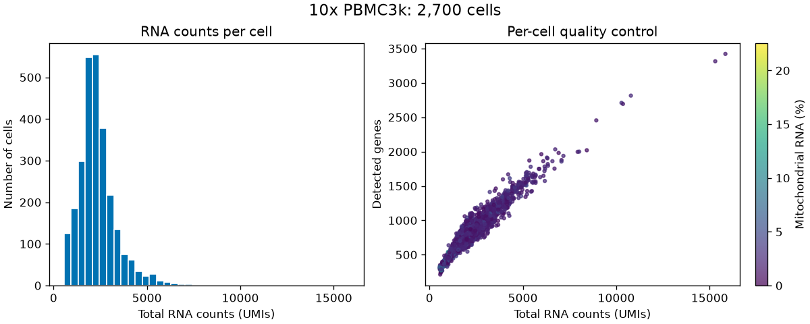

# PBMC3k: a small, reproducible notebook edit

This example uses the public 10x Genomics PBMC3k dataset through
[`scanpy.datasets.pbmc3k()`](https://scanpy.readthedocs.io/en/stable/generated/scanpy.datasets.pbmc3k.html).
Despite its name, the dataset contains **2,700 cells and 32,738 genes**.
It comes from a healthy donor; see the
[10x dataset page](https://support.10xgenomics.com/single-cell-gene-expression/datasets/1.1.0/pbmc3k).

The [one-code-cell notebook source](../examples/pbmc3k/analysis.py) calculates
per-cell RNA counts, detected genes, and mitochondrial RNA percentage. It plots
an RNA-count histogram and a QC scatter plot. It keeps all supplied cells and
does no filtering, clustering, or cell-type inference.

The edit is deliberately small:

```text
Change the RNA-count histogram from 40 to 60 bins. Preserve all QC calculations and the scatter plot.
```

The recorded run used the notebook-refactor skill: discover sessions, prepare,
read and edit only the returned Python percent script, preview, then apply.
The tool cleared cell 1's old outputs and execution count. It preserved the
cell ID and notebook metadata. Its conservative dependency analysis flagged
the plotting `for` loop as uncertain; there are no later cells in this notebook,
so no additional cells were cleared. We then explicitly reran the analysis,
as requested for this demo.

The maintained source starts at 40 bins so each reproduction begins with the
same edit. The regenerated local notebook ends at 60 bins.




## Reproduce without a model call

Use Python 3.12+ for this optional example. Notebook Workflow itself still
supports Python 3.10+ and does not require Scanpy.

From the repository root:

```bash
python3 -m venv .venv-pbmc3k
.venv-pbmc3k/bin/python -m pip install -e . -r examples/pbmc3k/requirements.txt
.venv-pbmc3k/bin/python examples/pbmc3k/run_demo.py replay
```

On Windows, use `.venv-pbmc3k\Scripts\python.exe` in place of
`.venv-pbmc3k/bin/python`.

The runner uses this interpreter through a temporary kernel specification;
it does not register or replace a global Jupyter kernel. Kernel communication
is encrypted, and each temporary kernel is shut down after execution, including
when a cell fails. The first run needs
internet access for the dataset and tokenizer vocabulary. It executes the small
notebook twice: before the edit and after applying it.

Replay invokes the maintained skill launcher and performs the fixed one-line
edit itself. It reproduces the tool behavior and input-text measurement without
requesting an AI completion. The original recorded run's edit was performed by
the assistant following the skill.

Results are written into the ignored `notebook-workflow-benchmarks/pbmc3k/`:

| Artifact | Purpose |
| --- | --- |
| `pbmc3k.ipynb` | Executed notebook after the 60-bin edit |
| `qc-before.png`, `qc-after.png` | Real before/after figures |
| `report.md` | Readable execution summary with token counts, checks, QC values, and figures |
| `report.json` | Token counts, versions, dataset hash, and verification results |
| `data/pbmc3k_raw.h5ad` | Scanpy's downloaded dataset cache |
| `workflow-trace.jsonl` | Actual launcher commands and compact responses |
| `notebook-workflow-sessions/` | Exported script and retained recovery artifacts |

Open **`report.md`** after replay and run VS Code's **Markdown: Open Preview**
command to view the summary and its linked figures. The JSON printed in the
terminal also identifies the Markdown report's path. With `--output`, both
reports appear in your chosen directory. See the
[recorded Markdown results](../examples/pbmc3k/report.md) for an example.

Keep backups, baselines, and notebook JSON outside the assistant's context.
The local measurement helper reads them privately and emits a compact report.
Only source code, reproduction instructions, derived figures, and the compact
[recorded report](../examples/pbmc3k/report.json) are shipped in this repository.

Choose a fresh output directory for another run:

```bash
.venv-pbmc3k/bin/python examples/pbmc3k/run_demo.py --output notebook-workflow-benchmarks/pbmc3k-rerun replay
```

The pinned example dependencies record the packages used for the published run;
the report records Python and other important package versions. The runner checks
the downloaded dataset's SHA-256. A changed upstream dataset fails that check
rather than silently comparing different data.

## Try it with Codex

Install the skill as described in the [installation guide](installation.md),
then generate an initial notebook in a fresh directory:

```bash
.venv-pbmc3k/bin/python examples/pbmc3k/run_demo.py --output notebook-workflow-benchmarks/pbmc3k-codex generate
```

Open `notebook-workflow-benchmarks/pbmc3k-codex/pbmc3k.ipynb` in VS Code and select
the `.venv-pbmc3k` Python interpreter as its kernel. The notebook already contains
its initial outputs. Ask Codex:

```text
Use $notebook-refactor on notebook-workflow-benchmarks/pbmc3k-codex/pbmc3k.ipynb.
Change the RNA-count histogram from 40 to 60 bins. Preserve all QC calculations and the scatter plot.
```

Pause notebook editing and execution during assistance. After Codex previews and
applies the change, confirm the cell's output was cleared, then rerun the cell to
see the 60-bin plot. This interactive route demonstrates the installed skill;
use `replay` for an automatically recorded, repeatable token comparison.

## What the token counts measure

The [measurement helper](../examples/pbmc3k/run_demo.py) uses `tiktoken`'s
`o200k_base` encoding. It counts these text bundles with the same request:

| Bundle | Contents | Recorded tokens |
| --- | --- | ---: |
| `notebook_and_request` | Request + exact original saved notebook JSON, including real stored outputs | 61,715 |
| `script_and_request` | Request + original exported percent script | 710 |
| `skill_including_overhead` | Request + script + complete skill instructions + logged launcher commands/responses | 2,895 |
| `cell_source_and_request` | Request + original code cell source | 491 |

The full notebook was **94,376 bytes**, including one **68,397-byte embedded PNG**.
Its lightweight exported script was **2,347 bytes**. Skill instructions add
**1,420 tokens** and the recorded command/response text adds **765 tokens**.
Commands and responses are counted once; machine paths and session directory
names are normalized to portable placeholders. No synthetic outputs were added.

The headline comparison is:

```text
tokens saved = 61,715 - 2,895 = 58,820
reduction = 58,820 / 61,715 × 100 = 95.3%
```

These are concatenated **input-text payload counts**, not a controlled comparison
of two billed model runs. They do not count shared system instructions, repeated
conversation context, reasoning or output tokens, or provider-specific message
wrappers. The helper makes no model request. Token counts and inline image bytes
can vary with generated cell labels, paths, first-download messages, fonts,
rendering, and package versions. A fresh replay verified the same behavior and
QC values, measuring a 95.4% reduction versus the recorded run's 95.3%.

The baseline matters: an assistant that already extracts code would need only
491 input-text tokens for this cell. The skill adds workflow overhead relative
to that baseline; its value then comes from safe application and output handling.
Reading an image through a vision-capable tool also has different accounting
from tokenizing its base64 representation in notebook JSON. This example measures
the benefit of avoiding a full stored notebook in text context.

The runner verifies the exact `bins=40` to `bins=60` source change, preserved cell
ID and notebook metadata, cleared execution state before rerunning, regenerated
inline plot output, and unchanged QC summary values after rerunning:

| QC summary | Before and after |
| --- | ---: |
| Cells | 2,700 |
| Genes | 32,738 |
| Median total RNA counts | 2,197 UMIs |
| Median detected genes | 817 |
| Median mitochondrial RNA | 2.029639% |
